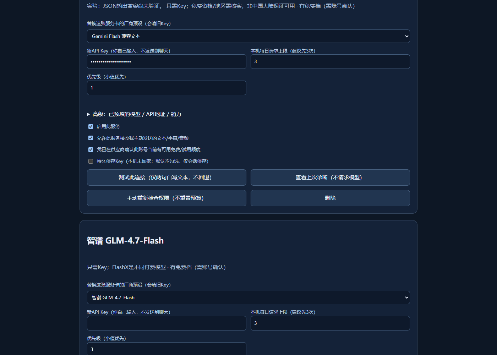

# LinguaLens 0.2.1 / R5 开发中开源版

可加载的Chrome/Edge MV3英语学习侧栏：英文主体、中文辅助、逐句跳转与循环、播放器全屏、双语章节/总结、词组及本地复习、STT短片段入口、浏览器本地优先朗读。无自建后端。原生YouTube真实24句/跳转/全屏已通过；Bilibili正常CC完整正文和真实模型英文输出尚未通过全部验收，不能称为全功能线上验证完成。

**先读 [详细安装与API教程](API-USAGE.zh-CN.md)**。已有字幕的AI学习需要文字服务；无字幕另需带segments的STT；本地英语朗读不需要云Key，云TTS可选。内置Groq、Gemini、OpenRouter、智谱、蚂蚁百灵、Agnes文字预设，其他高级服务可自行配置，但免费资格/地区/价格由用户确认，不承诺永久免费。

安装：先按下文从源码运行构建（`npm ci --ignore-scripts`、`npm run build`）→Edge `edge://extensions` / Chrome `chrome://extensions`→开发者模式→加载含manifest.json的 `dist/lingualens` 目录→刷新视频页。更新扩展会清session Key；用户自己选过的本地持久Key可保留，未加密、不sync。不要发送Key或密钥TXT到聊天，暴露后建议自行撤销换新。

新增厂商：顶部选择→看预览→点“新建服务卡（空Key）”→只在同名新卡亲自填Key→启用、数据许可、费用资格→保存并批准准确域。顶部不会改已有Groq卡。卡内替换厂商会清旧Key/许可，保留预算/优先级/保存方式；取消未保存改动恢复保存列表。用户窗口/Key从未被复制到交付包。

默认仅免费、每日3次。按能力/优先级有限回退；同origin+Key共享计数/冷却，修改配置不清计数。401按Key阻断，403按模型/区域账户阻断，429遵守Retry-After。主动重检不重置预算或429。只发送主动确认的文本/音频；网页不能取Key或指定任意模型端点。模型内容以textContent渲染，原句时间由本地保留。

YouTube优先正常“显示文字稿”DOM。B站只观察正常元数据/正文，不取Cookie、不造签名、不解密登录受限URL、不重放鉴权请求。正常播放器显示中文并不表示插件已经取得完整整轨；匿名回退的登录提示不能作为用户未登录的结论。可导入SRT/VTT或主动录制短片，替代路径不冒充原生CC成功。X未实现。

开发：Node24，`npm install --ignore-scripts`、`npm run build`、`npm test`。浏览器回归见package.json及tests/settings-interaction.mjs。测试仅在任务自有独立mock profile中读假Key；不会读取用户历史/真实Key/cookie。详细实测范围见 [测试报告](docs/validation.md)，三仓库研究/MIT许可见 [RESEARCH.md](RESEARCH.md) 与licenses/。本仓库提供源码与可加载的扩展构建；尚未发布到浏览器扩展商店。

R5修复：可见页面/后台/路由版本，单卡本次测试快照、Google安全诊断码、重复点击合并、旧结果失效；B站固定URL格式兼容、成功登录提示与拒绝区分、等待迟到正文、限定当前绑定轨道同语言空文件回退、取消/换P丢弃迟到结果。测试全部使用无Key/TEST mock。线上Gemini失败根因尚待运行版本与安全诊断确认，B站修复尚未真实联网复测，不称线上验收通过。


## 目录与源码范围

- `extension/`：完整MV3扩展源代码、样式和页面。
- `scripts/build.mjs`：检查JavaScript语法与manifest引用，构建可加载目录。
- `tests/`：确定性单元测试和隔离模拟页面回归；不会使用本机账号。
- `licenses/`：复用来源与许可，须随再分发保留。

## 从源码运行

```sh
git clone https://github.com/yangwei251003/lingualens.git
cd lingualens
npm ci --ignore-scripts
npm test
npm run build
```

在Chrome或Edge扩展管理页启用开发者模式，选择加载已解压的扩展，目录为`dist/lingualens`。无需自建服务端；调用外部模型时用户自行配置服务，公开源码不含任何可用API密钥。

## 当前验证与计划

2026-10-26公开迁移保留现有功能边界，运行确定性单元/构建检查；浏览器设置截图采用隔离profile和明确标记的虚构测试密钥。原作者的真实浏览器配置、实时服务诊断脚本、账号操作记录、缓存与既往私密控制文件不包含在源码仓库。B站原生CC与外部模型仍按上文标为待验证，不据单元测试宣称线上全功能可用。

后续优先完善B站原生字幕稳定性、配置引导与不同浏览器的回归。变更见CHANGELOG。

本次实际结果见[公开版验证](docs/validation.md)。
